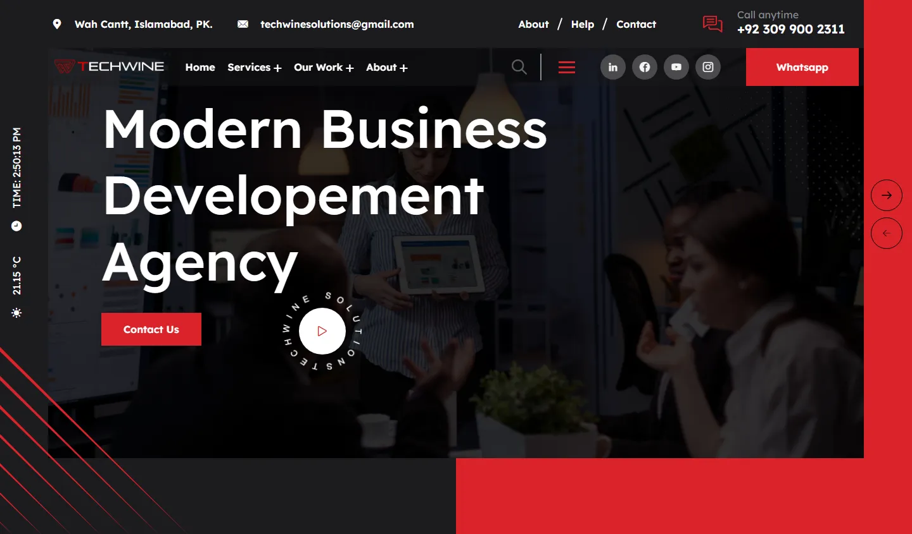
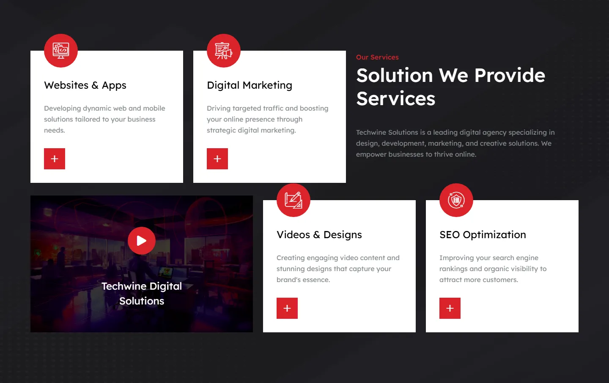
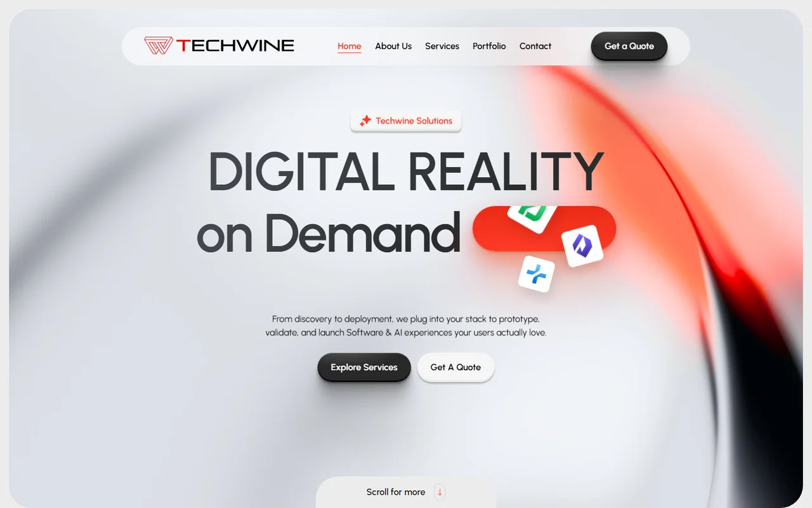

<div align="center">

# Techwine Solutions: first company website

The first public website of **Techwine Solutions**, Farhad Nazir's software company.<br>
A React single-page site deployed on Netlify.

**[techwine.netlify.app](https://techwine.netlify.app/)** · Current company site: **[techwinesolutions.com](https://www.techwinesolutions.com)**

</div>

<p align="center">
  
</p>

> [!NOTE]
> This is the company's **earlier** website and is no longer its main site. Techwine Solutions now runs on [techwinesolutions.com](https://www.techwinesolutions.com), a separate Laravel and Livewire application that is not in this repository ([case study](https://farhadnazir.com/projects/techwine-solutions/)).

## Branches

| Branch | Contents |
|---|---|
| `main` (default) | **The website source.** React 18 + Vite. Its `netlify.toml` builds with `npm run build` and publishes `dist/`. The routes in the live build match this branch. |
| [`master`](https://github.com/farhadnazir/techwine/tree/master) | Netlify's `create-react-app-lambda` starter the repository was created from (Create React App 3 with two example Netlify Functions). It is not the deployed site. |

## About the site

The site is a customised React agency template. The template's alternative demo homepages (`/index-2`, `/index-3`) and some placeholder images are still in the build.

**Pages** (React Router):

- Home: hero slider, introduction, services, latest projects, working process, team, "why choose us", testimonials, blog and footer
- About and Team
- Services, plus pages for Development, Digital Marketing, Design & Creatives and SEO services
- Portfolio, plus work pages for the same four categories and a portfolio detail page
- Blog (grid and list layouts) and blog post pages
- Contact, with a form that submits through [FormSubmit](https://formsubmit.co)
- A 404 page

The homepage hero also shows a live clock and the current temperature in Islamabad, fetched from the OpenWeatherMap API.

<table>
  <tr>
    <td width="68%" valign="top"></td>
    <td width="32%" valign="top"></td>
  </tr>
  <tr>
    <td align="center"><sub>Services section on the homepage</sub></td>
    <td align="center"><sub>Homepage on a phone</sub></td>
  </tr>
</table>

## Tech stack

React 18 · Vite 5 · React Router 6 · Bootstrap 5 · Sass · AOS (scroll animations) · React Slick (sliders) · Isotope · Yet Another React Lightbox · ESLint · Prettier · Netlify

## Run it locally

You need Node.js 18 or later:

```bash
git clone https://github.com/farhadnazir/techwine.git
cd techwine
npm install
npm run dev       # start the Vite dev server
npm run build     # production build in dist/
npm run preview   # serve the production build
npm run lint      # run ESLint
```

## The current website

<p align="center">
  <a href="https://www.techwinesolutions.com"></a>
</p>

[techwinesolutions.com](https://www.techwinesolutions.com) replaced this site. It is a Laravel 12 and Livewire 3 application with a custom admin panel for services, case studies, site settings, SEO metadata and leads. Read the [case study](https://farhadnazir.com/projects/techwine-solutions/).

## Products by Techwine Solutions

- **[Asaan Optics](https://asaanoptics.com):** optical shop software for Android and Windows, covering prescriptions, counter sales, stock and staff shifts. [Case study](https://farhadnazir.com/projects/asaan-optics/) · [Google Play](https://play.google.com/store/apps/details?id=com.techwinesolutions.asaanoptics)
- **[GeoPrints](https://www.techwinesolutions.com/geoprintsapp):** an Android travel diary that logs stays, routes and photos, with location history kept on the phone. [Google Play](https://play.google.com/store/apps/details?id=com.techwinesolutions.geoprintsapp)
- **[Asaan Rental Pro](https://github.com/farhadnazir/Asaan_rental_app):** an offline Windows desktop app for landlords to manage buildings, tenants, leases, rent and maintenance.

## Author

**Farhad Nazir**, full-stack software developer and founder of Techwine Solutions, based in Riyadh, Saudi Arabia.

[farhadnazir.com](https://farhadnazir.com) · [farhadnazirksa@gmail.com](mailto:farhadnazirksa@gmail.com) · [LinkedIn](https://www.linkedin.com/in/farhadnazir) · [WhatsApp +966 53 656 6380](https://wa.me/966536566380) · [GitHub](https://github.com/farhadnazir)
